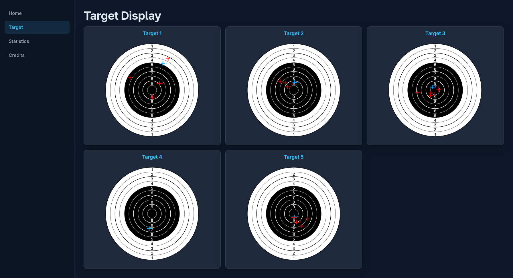
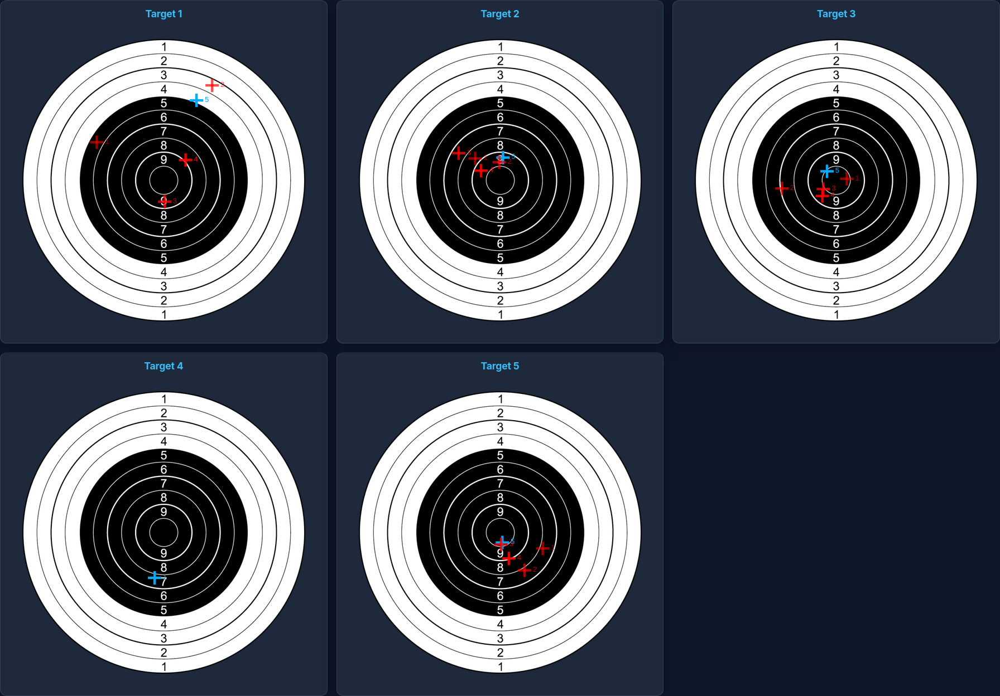
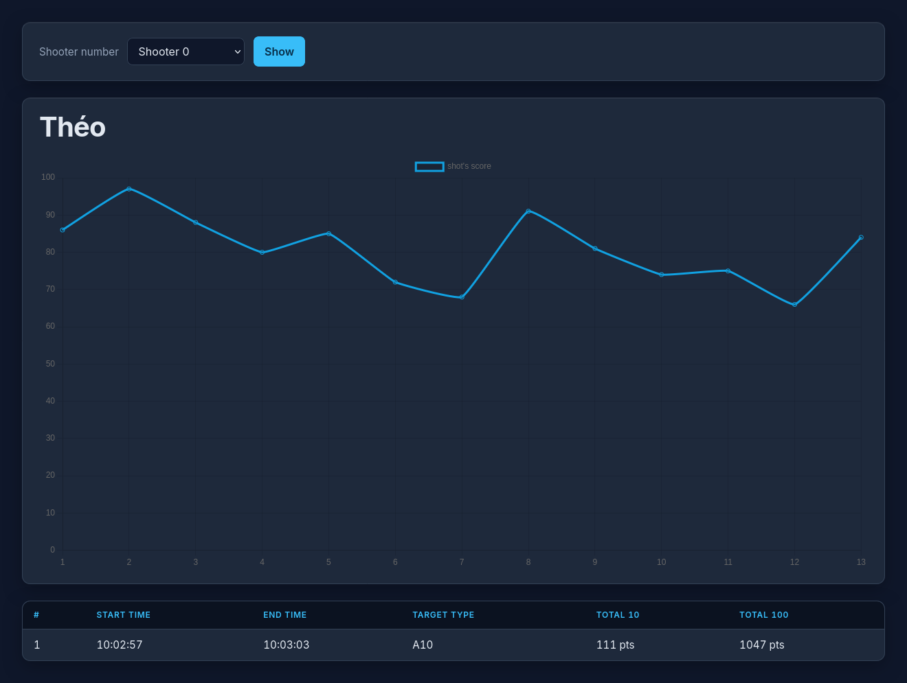
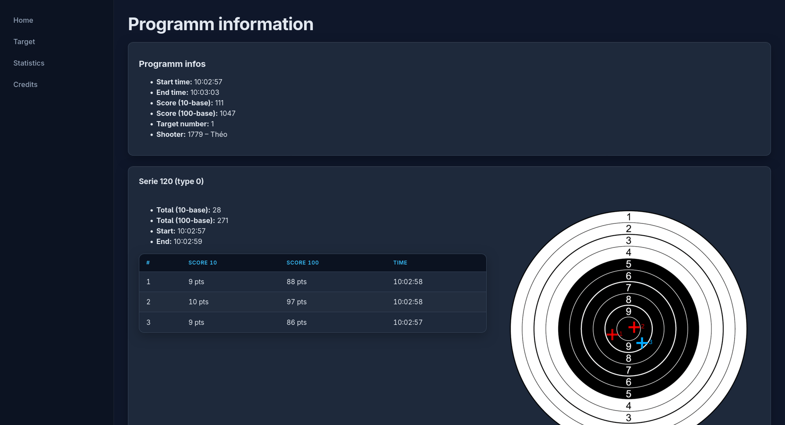

# polytronic‑target‑display

## Quick start

The project visualises live target‑shooting data received over a TCP socket.
With polytronic target system, you have to use the official software on windows. When the software run, it send all the data on the port `4000` over the TCP.
Data packets are parsed, stored in a MariaDB database, and served via a lightweight Flask API that a vanilla‑JS front‑end consumes.



<details><summary>data from the tcp exemple :</summary>

### Example of data the listener recieve (without useless data)

```python
# a shooter scan his stand's sheet's code bar
_NAME;3;4;1839;0;Shooter_name

# begin of a programm
_PRCH;3;4;1839;60;2;12:08:43.74;0;0;4;0;0;0;82;4;0;0;1839;0;0;0;0;0;0;0;2199063379

# begin of a serie
_GRPH;3;4;1839;60;11;12:09:39.26;8;0;0;0;0;0;1;2199068925
# shots
_SHOT;3;4;1839;60;12;12:09:39.46;3;0;2080;7;63;0;1;0.10984185;-0.15459728;900;0;0;655.35;2199068858;1;800;0
_SHOT;3;4;1839;60;13;12:09:50.44;3;0;2080;9;85;0;2;-0.05988752;-0.05386031;900;0;0;655.35;2199070032;1;800;0
# end of a serie
_SUBT;3;4;1839;60;14;12:10:03.40;7;0;0;0;2199071342

# begin of a serie
_GRPH;3;4;1839;60;15;12:10:19.19;8;0;1;1;0;0;1;2199072958
# shots
_SHOT;3;4;1839;60;16;12:10:19.58;3;0;2048;7;63;0;1;-0.04083079;-0.18700367;900;0;0;655.35;2199072919;1;800;0
_SHOT;3;4;1839;60;17;12:10:20.38;3;0;2048;10;91;0;2;0.00059842;0.05212176;900;0;0;655.35;2199072984;1;800;0
_SHOT;3;4;1839;60;18;12:10:20.97;3;0;2048;9;87;0;3;-0.06805410;-0.01731354;900;0;0;655.35;2199073032;1;800;0
_SHOT;3;4;1839;60;19;12:10:21.95;3;0;2048;8;79;0;4;-0.10944988;-0.01268458;900;0;0;655.35;2199073082;1;800;0
_SHOT;3;4;1839;60;20;12:10:22.56;3;0;2048;8;79;0;5;0.01755792;-0.11199880;900;0;0;655.35;2199073142;1;800;0
# end of a serie
_SUBT;3;4;1839;60;33;12:11:49.50;7;0;41;385;2199081970

# signal the end of the programm
_PRST;3;4;1839;51;0

```

### data explication

for a random shot

```
_SHOT -> Data type
3 -> target number, start at 0
4 -> target number, start at 1
1839 -> shooter number
60 -> ? (same everywhere)
2 -> the data's id (reset after reboot)
12:08:43.74 -> time
3 -> ? (same everywhere)
0 -> ? (same everywhere)
2048 -> ? (same everywhere)
9 -> Score 10 based (score between 0-10)
90 -> Score 100 based (score between 0-100)
0 -> ? (same everywhere)
7 -> the number of the shot in the series
-0.04698670 -> x impact's pos
0.03425682 -> y impact's pos
900 -> ? (same everywhere)
0 -> ? (same everywhere)
0 -> ? (same everywhere)
655.35 -> ? (same everywhere)
2199073245 -> the GUID (unique, don't reset after reboot)
1 -> ? (same everywhere)
800 -> ? (same everywhere)
0 ? (same everywhere)
```

</details>

## Features

- shots shows in live, to display on a tv.
  
- Graph of average shots of a shooter
  
- history of the last programm for each shooter
  

---

## Prerequisites

| Item                | Minimum       | Notes                                                            |
| ------------------- | ------------- | ---------------------------------------------------------------- |
| **Python**          | 3.11 or newer | The project is written in pure Python.                           |
| **pip**             | –             | Python’s package manager.                                        |
| **MariaDB**         | 10.5+         | Any server compatible with the `mariadb` driver.                 |
| **A pc on windows** | 8, 10 or 11   | To run the polytronic's software, this server can also run on it |

---

## Installation (Manual)

```bash
# 1. Clone the repository
git clone https://github.com/theolaederach/polytronic-target-display
cd polytronic-target-display

# 2. Create a virtual environment (recommended)
python -m venv .venv
source .venv/bin/activate   # On Windows: .venv\Scripts\activate

# 3. Install Python dependencies
pip install -r requirements.txt
```

### Database setup

```bash
# Create the database and run the schema
# Replace <user> and <db_name> with your credentials
mysql -u <user> -p <db_name> < database/create_structure.sql
```

or with docker

```bash
# create the container for mariadb
docker run \
  --name polytronic-mariadb \
  -e MARIADB_ROOT_PASSWORD=password \
  -e MARIADB_DATABASE=polytronic-target-display \
  -p 3306:3306 \
  -d mariadb:latest

# create the db
docker exec -i polytronic-mariadb \
  mysql -uroot -ppassword polytronic-target-display \
  < database/create_structure.sql

```

The SQL script creates the tables `programm`, `series`, and `shots`.

### Environment variables

Copy the example file and edit it with your own values:

```bash
cp .env.example .env
```

Required variables:

| Variable               | Description                                   | Example                                 |
| ---------------------- | --------------------------------------------- | --------------------------------------- |
| `DATABASE_URL`         | Hostname or IP of the MariaDB server          | `localhost`                             |
| `DATABASE_PORT`        | DB port (default 3306)                        | `3306`                                  |
| `DATABASE_USER`        | DB user                                       | `user`                                  |
| `DATABASE_PASSWORD`    | DB password                                   | `password`                              |
| `DATABASE_NAME`        | DB name                                       | `polytronic-target-display`             |
| `HOST_LISTENER`        | IP to bind the TCP listener (e.g. `0.0.0.0`)  | `0.0.0.0`                               |
| `PORT_LISTENER`        | Port for the TCP listener (default `4000`)    | `4000`                                  |
| `ALLOWED_IPS_LISTENER` | Allowed IPs for the listener                  | `127.0.0.1,192.168.1.100,192.168.1.101` |
| `HOST_WEB_SERVER`      | Host to bind the Flask server                 | `0.0.0.0`                               |
| `PORT_WEB_SERVER`      | Port for the Flask server (default `5000`)    | `5000`                                  |
| `NumberOfTarget`       | Number of targets to initialise (default `5`) | `5`                                     |
| `OPENWEATHER_API_KEY`  | The api key to get the weather on the webpage | `ahjsbrev36ab81na81ns8rn329a`           |
| `OPENWEATHER_LAT`      | The **latitude** of the stand                 | `46.9041`                               |
| `OPENWEATHER_LON`      | The **longitude** of the stand                | `7.5957`                                |

---

## Running the application

```bash
# With the virtual environment activated
python main.py
```

- `main.py` starts a Flask web server (default on port 5000) **and** launches a background thread that listens on the TCP port defined by `PORT_LISTENER`.
- The front‑end is served at `http://localhost:5000/` and automatically polls the API for shot data.

```bash
# argument for main.py :$
options:
  -h, --help            show this help message and exit
  --web_server_only     Start the web server without the tcp listening
  --web_server-host WEB_SERVER_HOST
                        Setup the host of the web server, DEFAULT 0.0.0.0
  --web_server-port WEB_SERVER_PORT
                        Setup the port of the web server, DEFAULT 5000
  --debug DEBUG         Set the web server (Flask) into debug mode
  --listener_only       Start the TCP listener without the web server
  --listen-ip LISTEN_IP
                        Listen address TCP (défaut: 0.0.0.0)
  --listen-port LISTEN_PORT
                        Listen port TCP (défaut: 4000)
```

### Stopping

Press `Ctrl+C` in the terminal that ran `app.py` – both the Flask server and the TCP listener will terminate.

---

## To do

- [ ] Make the home page of the website
- [ ] Create an auto-install script
- [ ] print auto-genereted stand sheet
- [ ] Add a `date` column to `programm` table
- [ ] Add a zone for sponsors and results table

<details><summary>Alreader done</summary>

- [x] make the target on the web page responsive
- [x] auto change the type of target on the webpage
- [x] Add charts and statistics for each shooter
- [x] Use the `_NAME` from the database in a shooter table.
- [x] Make the web server and the listener independant
- [x] change the `guid` by the `id` of the `shots`/`series`/`programm` and add a table of the `curreent` `shots`/`series`/`programm` for each target.

</details>

---

## Project layout

```
polytronic‑target‑display/                       # project root
├─ main.py                                      # entry point (Flask + listener)
├─ listener.py                                  # TCP listener + parser
├─ database/                                    # data‑access layer
│  ├─ __init__.py
│  ├─ connection.py
│  ├─ reader.py
│  ├─ writer.py
│  └─ src/
│      └─ create_structure.sql                 # MariaDB schema
├─ server/                                      # Flask app + web interface
│  ├─ app.py
│  ├─ api/
│  │  └─ shots.py
│  ├─ routes/
│  │  └─ app_routes.py
│  ├─ static/
│  │  ├─ assets/                               # target images
│  │  │  └─ target_A10.png
│  │  ├─ js/
│  │  │  └─ update‑target.js
│  │  ├─ favicon.ico
│  │  ├─ fullscreen.css
│  │  └─ style.css
│  └─ templates/
│      ├─ home.html
│      ├─ target.html
│      ├─ target_fs.html
│      └─ credits.html
├─ requirements.txt
├─ .gitignore
├─ .env.example
├─ README.md
├─ AGENTS.md
└─ doc.md
```

---

## Contribution

Feel free to fork, create feature branches, and submit pull requests. Please keep the coding style consistent with the existing code (PEP‑8 for Python, camelCase for JS). Adding tests is appreciated.

---

Please appreciate the work we’ve put in; my brother and I spent four hours analysing each line, one by one, to understand the values. [Look what we've done!](#data-explication)

> Made by [theolaederach](https://github.com/theolaederach) – co‑authored with AI.
